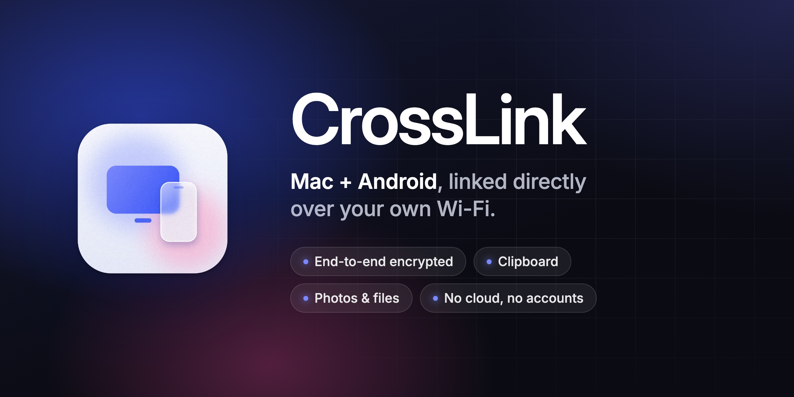
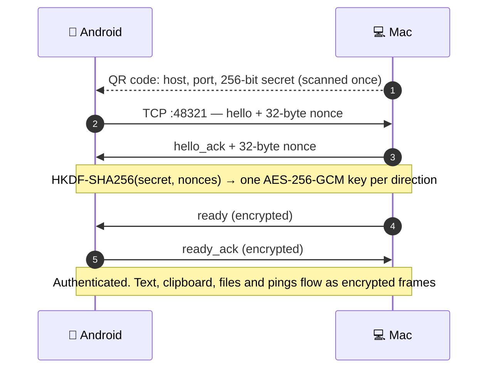

<p align="center">
  
</p>

<p align="center">
  <b>Send text, clipboard, photos and files between your Mac and your Android phone.</b><br>
  Directly over your local network, end-to-end encrypted. No accounts, no cloud, no servers.
</p>

<p align="center">
  <a href="https://github.com/WayupKG/CrossLink/actions/workflows/ci.yml"></a>
  <a href="LICENSE"></a>
  
  
  
  
</p>

<p align="center">
  <a href="#-features">Features</a> ·
  <a href="#-how-it-works">How it works</a> ·
  <a href="#-getting-started">Getting started</a> ·
  <a href="#-repository-layout">Layout</a> ·
  <a href="#-roadmap">Roadmap</a> ·
  <a href="README.ru.md">Русский</a>
</p>

---

CrossLink is a native pair of apps — a **macOS menu bar app** (SwiftUI) and an **Android app**
(Kotlin, Jetpack Compose) — that talk to each other over a single encrypted TCP connection on your
Wi-Fi. You pair them once by scanning a QR code; after that the phone finds the Mac on its own,
even when the Mac's IP address changes.

> [!NOTE]
> CrossLink is at version **0.2** and is developed for personal use. The interface is currently
> in Russian, there are no prebuilt binaries yet, and it has been tested on one Mac and one
> Android phone. See [Status and limitations](#-status-and-limitations).

## ✨ Features

| | |
|---|---|
| 📋 **Clipboard, both ways** | Send what you copied on one device to the clipboard of the other. Optional automatic sync Mac → Android. |
| 💬 **Text and links** | Type a message or share a link from either side; links open with one tap. |
| 🖼️ **Photos and files** | Up to 4 GB per file, verified with SHA-256. Photos and videos land in the phone's gallery, everything else in Downloads. |
| 🔐 **End-to-end encrypted** | AES-256-GCM with per-direction keys derived by HKDF-SHA256 from a 256-bit secret in the QR code. Replayed or reordered frames are rejected. |
| 🔌 **Stays connected** | A foreground service keeps the link alive in the background, pings every 20 s and reconnects after Wi-Fi drops, reboots and app updates. |
| 📡 **Finds your Mac** | If the Mac's IP changes, the phone finds it again over Bonjour (`_crosslink._tcp`) without exposing the pairing secret. |
| 🕘 **History** | The last 50 items sent or received on each side, kept in memory only — clipboard contents never touch the disk. |
| 🎨 **Native on both sides** | Menu bar app on the Mac, Material 3 with light and dark theme on Android, the same design tokens and Inter typeface on both. |

### Ways to send

**From the Mac**

- The CrossLink menu in the menu bar: text, clipboard, **Файлы…** (Files…)
- Finder: **Open With → CrossLink** or **Services → Отправить на телефон** (Send to phone)
- Optional automatic clipboard sync to the phone

**From the phone**

- **Share → CrossLink** from any app, or the **Фото** / **Файл** (Photo / File) buttons
- Select text → **CrossLink** in the text selection menu
- The **Буфер → Mac** (Clipboard → Mac) Quick Settings tile or a tap on the CrossLink notification
- Open the app: newly copied text goes to the Mac on its own (except text marked as sensitive)

## 🧩 How it works



- **Pairing is the trust decision.** The secret travels only inside the QR code. It is stored in the
  macOS Keychain and, on Android, encrypted with a non-exportable Android Keystore key. Resetting
  pairing on the Mac rotates the key and invalidates the phone.
- **Every frame is authenticated.** Each message carries a sequence number that must be exactly the
  previous one plus one, so replays and reordering fail closed.
- **Files stream in chunks** of 192 KiB behind TCP backpressure, so memory stays flat and texts and
  pings slip in between. A file becomes visible only after its SHA-256 matches; on the Mac it gets
  the quarantine attribute so Gatekeeper checks it before it runs.
- **Strangers on the LAN can't kick your phone off.** The Mac swaps its phone only for a connection
  that completed the encrypted handshake.

The full wire format — framing, handshake, messages and file transfer — is specified in
[**PROTOCOL.md**](PROTOCOL.md) and checked by independent [Python contract tests](tests/test_protocol.py).

## 🚀 Getting started

### Requirements

| macOS app | Android app |
|---|---|
| macOS 13 Ventura or later | Android 10 (API 29) or later |
| Xcode with Command Line Tools | Android Studio with SDK Platform 36 |
| [Homebrew](https://brew.sh) and `xcodegen` | JDK 17 |

Both devices must be on the **same Wi-Fi or LAN**. Guest networks with client isolation and some
VPNs block the connection.

### macOS

```bash
brew install xcodegen
macos/make-signing-cert.sh   # once per Mac: a local code signing certificate
macos/install.sh             # builds Release, installs to /Applications and launches it
```

The CrossLink icon appears in the menu bar. On first launch macOS asks for access to the pairing
key in the Keychain — choose **Always Allow**. The local certificate keeps the signature the same
from build to build, so macOS doesn't ask again after updates. Allow local network access and
incoming connections if macOS asks: the app listens on TCP port `48321`.

For development: `cd macos && xcodegen generate && open CrossLink.xcodeproj`.

### Android

```bash
cd android
./gradlew assembleDebug      # APK: app/build/outputs/apk/debug/app-debug.apk
./gradlew installDebug       # or install straight to a connected phone
```

Or open the `android/` folder in Android Studio and press **Run**. The QR scanner uses Google Play
services; without them, copy the pairing code on the Mac and paste it on the phone.

### First pairing

1. Open the CrossLink menu on the Mac — it shows a QR code.
2. On the phone, open CrossLink and tap **Сканировать QR-код** (Scan QR code).
3. Wait for **Подключено к Mac · зашифровано** (Connected · encrypted) on both sides.
4. Send a message from the phone, then one back from the Mac.
5. Copy something on the phone and tap the CrossLink notification — it's on the Mac's clipboard.

> [!WARNING]
> Anyone who sees the QR code can connect to your Mac. Don't post it in chats or screenshots.
> Leave automatic clipboard sync **off** if you copy passwords, payment details or one-time codes.

## 🗂 Repository layout

This is a monorepo: both apps, the shared protocol spec, its tests and the design sources live
together and change together.

```
CrossLink/
├── macos/                    macOS menu bar app (Swift, SwiftUI, Network.framework)
│   ├── CrossLink/            sources: MacLinkManager (TCP listener, protocol), Pairing (QR, Keychain)
│   ├── project.yml           XcodeGen project definition
│   ├── install.sh            build Release → /Applications
│   └── make-signing-cert.sh  local code signing certificate
├── android/                  Android app (Kotlin, Jetpack Compose, Material 3)
│   └── app/src/main/java/kg/crosslink/app/
│       ├── LinkController.kt protocol client, encryption, file transfer
│       ├── LinkService.kt    foreground service that keeps the link alive
│       ├── MacFinder.kt      Bonjour discovery of the paired Mac
│       └── SavedPairing.kt   pairing secret sealed by Android Keystore
├── tests/                    Python contract tests of the wire protocol
├── design/                   logo and icon sources, export scripts, README banner
├── docs/assets/              images for this README
├── licenses/                 third-party licenses shipped inside both apps
└── PROTOCOL.md               wire protocol v1 specification
```

## 🧪 Testing

The protocol has an independent reference implementation in Python that checks the spec:
key derivation, framing, encryption, sequence numbers, Bonjour IDs and file transfer.

```bash
python3 -m venv .venv && .venv/bin/pip install -r tests/requirements.txt
.venv/bin/python -m unittest discover -s tests -v
```

[CI](.github/workflows/ci.yml) runs these tests and builds both apps on every push and pull request.

## 🚧 Status and limitations

- **No prebuilt releases yet.** Build the apps from source as described above.
- **The interface is in Russian.** English localization is planned.
- **Android → Mac clipboard needs one tap.** Since Android 10, a regular app can read the clipboard
  only while it is on screen. CrossLink does not use Accessibility or `READ_LOGS` workarounds,
  which Google Play doesn't allow — tap the notification, the Quick Settings tile, or open the app.
- **Some Android skins kill background apps.** On vivo, Xiaomi and similar firmware, allow CrossLink
  to auto-start and run in the background. If the system still stops it, open the app and tap
  **Подключиться** (Connect).
- **One phone per Mac.** Interrupted file transfers don't resume yet — send the file again.
- **LAN only.** Don't forward port `48321` to the Internet. The protocol has not had an external
  security review.

## 🗺 Roadmap

- [ ] Companion Device Manager, so background work doesn't depend on battery settings
- [ ] Resuming interrupted file transfers
- [ ] Clipboard exclusions (passwords) and a pause switch
- [ ] Phone notifications on the Mac (with explicit consent and per-app filters)
- [ ] English interface
- [ ] Several paired devices
- [ ] Google Play release and a notarized Mac build
- [ ] Optional end-to-end relay over the Internet

## 🤝 Contributing

Issues and pull requests are welcome — see [CONTRIBUTING.md](CONTRIBUTING.md).
Found a security problem? Please report it privately as described in [SECURITY.md](SECURITY.md).

## 📄 License

CrossLink is released under the [MIT License](LICENSE).

It bundles the [Inter](https://rsms.me/inter/) typeface (SIL Open Font License 1.1, © The Inter
Project Authors), subset to Latin and Cyrillic, and icons from [Lucide](https://lucide.dev) (ISC).
Their licenses are in [`licenses/`](licenses) and ship inside both apps.
